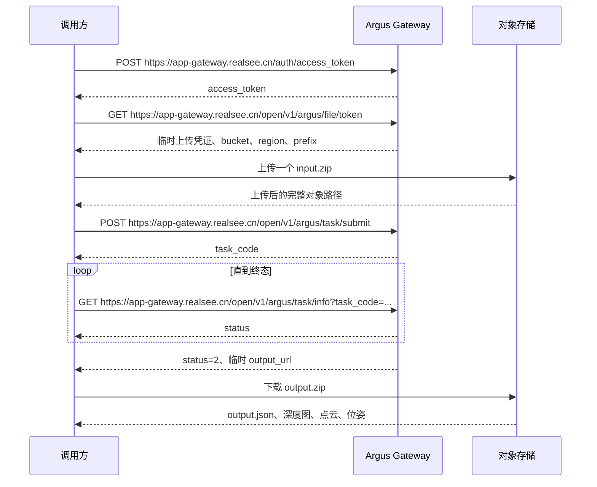

# Argus API 接口契约、数据结构与调用工作流

**版本：Argus 1.0**

Realsee Argus 是全球领先的 3D 视觉基础模型。它可从照片、全景图或稀疏视图中，在毫秒级重建具备度量尺度的 3D 结构，包括位姿、深度、点云和可渲染几何。Argus API 以异步任务方式提供该能力。

## 1. 接口契约

### 1.1 获取访问令牌

#### 1.1.1 请求地址

```http
POST https://app-gateway.realsee.cn/auth/access_token
```

#### 1.1.2 请求头

```http
Content-Type: application/x-www-form-urlencoded
```

#### 1.1.3 请求体

```text
app_key=<app_key>&app_secret=<app_secret>
```

| 字段 | 类型 | 必选 | 说明 |
| --- | --- | --- | --- |
| `app_key` | string | 是 | 应用标识，不能为空 |
| `app_secret` | string | 是 | 应用密钥，不能为空，不得记录到日志 |

#### 1.1.4 响应体

```json
{
  "request_id": "<request_id>",
  "trace_id": "<trace_id>",
  "business_code": "<business_code>",
  "osi_request_id": "<osi_request_id>",
  "code": 0,
  "status": "success",
  "data": {
    "access_token": "<access_token>",
    "expire_at": 1710000000
  },
  "cost": 12
}
```

| 字段 | 类型 | 说明 |
| --- | --- | --- |
| `code` | integer | 业务状态码，成功时为数字 `0` |
| `status` | string | 状态或错误信息 |
| `data.access_token` | string | 后续接口使用的短期访问令牌 |
| `data.expire_at` | integer | 访问令牌的 Unix 过期时间戳 |
| `request_id`、`trace_id` | string | 请求追踪标识 |

> 注意：只有 `code` 为数字 `0` 且 `data.access_token` 非空时，才可认为鉴权成功。访问令牌不得记录到日志或持久化文件。

### 1.2 获取文件上传凭证

#### 1.2.1 请求地址

```http
GET https://app-gateway.realsee.cn/open/v1/argus/file/token
```

#### 1.2.2 请求头

```http
Authorization: <access_token>
```

#### 1.2.3 请求参数

无。

#### 1.2.4 响应体

```json
{
  "request_id": "<request_id>",
  "trace_id": "<trace_id>",
  "business_code": "<business_code>",
  "osi_request_id": "<osi_request_id>",
  "code": 0,
  "status": "success",
  "data": {
    "tmpSecretId": "<tmpSecretId>",
    "tmpSecretKey": "<tmpSecretKey>",
    "sessionToken": "<sessionToken>",
    "bucket": "<bucket>",
    "region": "<region>",
    "prefix": "<prefix>",
    "expire": 1710003600,
    "ttl": 3600
  },
  "cost": 12
}
```

| 字段 | 类型 | 说明 |
| --- | --- | --- |
| `code` | integer | 业务状态码，成功时为数字 `0` |
| `data.tmpSecretId` | string | 临时对象存储访问标识 |
| `data.tmpSecretKey` | string | 临时对象存储访问密钥 |
| `data.sessionToken` | string | 临时对象存储会话令牌 |
| `data.bucket` | string | 上传目标 Bucket |
| `data.region` | string | 对象存储区域 |
| `data.prefix` | string | 本次上传允许使用的对象路径前缀 |
| `data.expire` | number | 临时凭证过期信息 |
| `data.ttl` | number | 临时凭证有效时长 |

> 注意：`tmpSecretId`、`tmpSecretKey` 和 `sessionToken` 只用于当前上传过程，不得记录到日志或持久化文件。只有 `code` 为数字 `0` 且上述必选字段均非空时，才可开始上传。

### 1.3 提交任务

调用本接口前，调用方应使用 1.2 返回的临时凭证，把一个符合第 2 章约束的 `input.zip` 上传至对象存储，并取得完整对象路径。

#### 1.3.1 请求地址

```http
POST https://app-gateway.realsee.cn/open/v1/argus/task/submit
```

#### 1.3.2 请求头

```http
Authorization: <access_token>
Content-Type: application/json
```

#### 1.3.3 请求体

```json
{
  "private_cos_keys": ["<上传后的完整对象路径>"],
  "title": "<任务标题>"
}
```

| 字段 | 类型 | 必选 | 说明 |
| --- | --- | --- | --- |
| `private_cos_keys` | string[] | 是 | 已上传对象的完整路径；当前任务传入一个 ZIP 路径 |
| `title` | string | 是 | 非空任务标题 |

#### 1.3.4 响应体

```json
{
  "request_id": "<request_id>",
  "trace_id": "<trace_id>",
  "business_code": "<business_code>",
  "osi_request_id": "<osi_request_id>",
  "code": 0,
  "status": "success",
  "data": {
    "task_code": "<task_code>"
  },
  "cost": 12
}
```

| 字段 | 类型 | 说明 |
| --- | --- | --- |
| `code` | integer | 业务状态码，成功时为数字 `0` |
| `data.task_code` | string | 后续查询任务状态使用的持久任务标识 |

> 注意：只有 `code` 为数字 `0` 且 `data.task_code` 非空时，才可认为任务提交成功。该接口不具备幂等性；如果提交请求结果不明确，不得自动重试，否则可能创建重复任务。

### 1.4 查询任务

#### 1.4.1 请求地址

```http
GET https://app-gateway.realsee.cn/open/v1/argus/task/info?task_code=<task_code>
```

#### 1.4.2 请求头

```http
Authorization: <access_token>
```

#### 1.4.3 请求参数

| 参数 | 位置 | 类型 | 必选 | 说明 |
| --- | --- | --- | --- | --- |
| `task_code` | Query | string | 是 | 1.3 提交接口返回的任务标识 |

#### 1.4.4 响应体

```json
{
  "request_id": "<request_id>",
  "trace_id": "<trace_id>",
  "business_code": "<business_code>",
  "osi_request_id": "<osi_request_id>",
  "code": 0,
  "status": "success",
  "data": {
    "status": 2,
    "output_url": "<临时 output.zip 下载地址>",
    "expiration_timestamp": 1710003600,
    "error_message": "",
    "create_timestamp": 1710000000,
    "modify_timestamp": 1710000300
  },
  "cost": 12
}
```

| 字段 | 类型 | 说明 |
| --- | --- | --- |
| `code` | integer | 业务状态码，成功时为数字 `0` |
| `data.status` | integer | 任务状态：`0` 排队、`1` 处理、`2` 成功、`3` 失败 |
| `data.output_url` | string | 成功后的临时 `output.zip` 下载地址；非终态为空字符串 |
| `data.expiration_timestamp` | integer | `output_url` 的 Unix 过期时间戳 |
| `data.error_message` | string | 任务失败信息；非失败状态通常为空字符串 |
| `data.create_timestamp` | integer | 任务创建时间 |
| `data.modify_timestamp` | integer | 任务最后更新时间 |

> 注意：只有 `code` 为数字 `0` 时，才可读取 `data.status`。`data.status` 为 `2` 时，`output_url` 必须非空；`data.status` 为 `3` 时，应按失败处理并读取 `error_message`。`output_url` 是临时地址，不得作为长期产物地址保存或对外暴露。

## 2. 输入输出数据结构

### 2.1 输入 ZIP

Argus 每次任务接收一个 ZIP，压缩包根目录只能包含 1–99 张图片：

```text
input.zip
├── 客厅.jpg
├── 厨房.png
└── 露台.webp
```

每张图片必须满足：

- 格式为 JPEG、PNG 或 WebP；
- RGB 三通道、每通道 8-bit；
- 严格 2:1 的等距矩形全景图，即 `width == 2 * height`；
- 位于 ZIP 根目录；
- 文件名不包含路径穿越、控制字符、重复 stem 或 Unicode/case-fold 冲突。

低于 2048×1024 的图片会产生质量警告，但不属于硬错误。

输入文件名使用 Unicode NFC 规范化，并按规范化后的 UTF-8 字节序排序。算法按该顺序从 `000000` 开始分配六位图片 ID。输入 ID 与文件名的权威对应关系由输出 `name_mapping` 给出，调用方不得自行推导。

### 2.2 输出 ZIP

任务成功后，`output_url` 指向一个结果 ZIP：

```text
output.zip
├── output.json
├── depth/
│   ├── 000000_depth.exr
│   └── 000001_depth.exr
├── pointcloud/
│   └── merged.glb
└── pose/
    ├── 000000_pose.json
    └── 000001_pose.json
```

| 产物 | 数据契约 |
| --- | --- |
| `output.json` | 必选的算法结果 Manifest |
| `depth/*_depth.exr` | 32-bit 浮点 EXR 深度图，单位为米 |
| `pointcloud/merged.glb` | 合并点云，坐标系为 `right-handed, Y-up` |
| `pose/*_pose.json` | 对应图片的相机位姿 |

### 2.3 `output.json`

`output.json.status` 有三种取值：

| `status` | 语义 |
| --- | --- |
| `success` | 所有输入图片均成功，每个 ID 都有深度图和位姿 |
| `partial` | 部分图片成功，必须提供非空且唯一的 `missing_ids` |
| `error` | 算法失败，必须提供 `error.code` 和 `error.message` |

成功结果示例：

```json
{
  "version": "1.0",
  "status": "success",
  "name_mapping": {
    "000000": "客厅.jpg"
  },
  "depth_maps": [
    {
      "image_id": "000000",
      "path": "depth/000000_depth.exr",
      "format": "exr",
      "resolution": [4096, 2048],
      "unit": "meter"
    }
  ],
  "point_cloud": {
    "path": "pointcloud/merged.glb",
    "format": "glb",
    "vertex_count": 1234567,
    "has_color": true,
    "has_normals": false,
    "coordinate_system": "right-handed, Y-up"
  },
  "poses": [
    {
      "image_id": "000000",
      "path": "pose/000000_pose.json",
      "format": "json"
    }
  ]
}
```

部分成功结果在上述结构基础上增加：

```json
{
  "status": "partial",
  "missing_ids": ["000001"]
}
```

算法失败结果只包含：

```json
{
  "version": "1.0",
  "status": "error",
  "error": {
    "code": "RECONSTRUCTION_FAILED",
    "message": "No frame could be reconstructed."
  }
}
```

### 2.4 位姿数据

每个成功图片 ID 对应一份位姿 JSON：

```json
{
  "image_id": "000000",
  "rotation": [
    [1, 0, 0],
    [0, 1, 0],
    [0, 0, 1]
  ],
  "translation": [0, 0, 0],
  "coordinate_system": "right-handed, Y-up"
}
```

`rotation` 是 3×3 世界坐标系到相机坐标系旋转矩阵，`translation` 是世界原点在相机坐标系中的位置。

## 3. 调用工作流



### 3.1 鉴权

调用鉴权接口。只有响应 `code` 为 `0`、`data.access_token` 非空且 `data.expire_at` 有效时，才进入下一步。

### 3.2 获取上传凭证并上传 ZIP

使用访问令牌调用文件上传凭证接口。根据返回的临时凭证、`bucket`、`region` 和 `prefix` 上传一个符合输入契约的 ZIP，并取得完整对象路径。上传失败时不得提交任务。

### 3.3 提交任务

将完整对象路径放入 `private_cos_keys` 后调用任务提交接口。保存返回的 `task_code`，后续所有状态查询均使用该值。

提交接口不可自动重试。若响应结果不明确，应先确认任务是否已创建，不能直接再次提交同一输入。

### 3.4 查询任务状态

使用 `task_code` 调用任务查询接口：

- `data.status = 0`：任务排队，稍后再次查询；
- `data.status = 1`：任务处理中，稍后再次查询；
- `data.status = 2`：任务成功，校验 `output_url` 和 `expiration_timestamp` 后下载；
- `data.status = 3`：任务失败，读取 `error_message` 并终止工作流。

查询接口每次返回一个状态快照。轮询间隔、最大等待时长和超时策略由调用方控制。

### 3.5 下载并校验结果

任务成功后，在 `expiration_timestamp` 前下载 `output_url` 指向的 `output.zip`。下载完成后至少执行以下校验：

1. ZIP 可完整解压，且不存在路径穿越、重复路径或越界文件；
2. `output.json` 满足第 2.3 节定义；
3. `output.json` 引用的所有文件真实存在；
4. 深度图、位姿和 `name_mapping` 的图片 ID 集合一致；
5. GLB 与 EXR 文件头符合声明格式；
6. `partial` 结果完整报告 `missing_ids`；
7. `error` 结果按失败处理，不消费不存在的产物。

下载并持久化实际产物后，应丢弃临时 `output_url`，后续消费使用受控存储中的结果文件。
